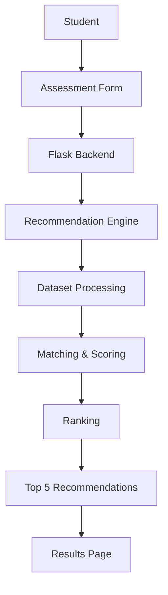

<div align="center">

# AI Career Internship & Job Recommendation System

**Personalized job and internship recommendations for students, driven by academic profile, skills, and career interests.**

## Table of Contents

- [Overview](#overview)
- [Key Features](#key-features)
- [Technology Stack](#technology-stack)
- [System Architecture](#system-architecture)
- [Recommendation Methodology](#recommendation-methodology)
- [Dataset](#dataset)
- [Project Structure](#project-structure)
- [Getting Started](#getting-started)
- [Usage](#usage)
- [Limitations](#limitations)
- [Future Enhancements](#future-enhancements)
- [Author](#author)
- [Acknowledgements](#acknowledgements)
- [License](#license)

---

## Overview

Students often struggle to identify which roles align with their educational background and technical capabilities. This web application addresses that problem by matching a student's profile against real-world postings from the **LinkedIn Job Postings Dataset**.

Users submit their degree, course, academic year, CGPA, skills, and career interests. The system scores each posting against the profile, ranks the results, and presents the **top five opportunities** through a responsive web interface.

## Key Features

| Feature | Description |
|---|---|
| **Student Profile Assessment** | Captures degree, course, academic year, and CGPA. |
| **Skill-Based Matching** | Compares technical skills against job requirements. |
| **Course-Based Matching** | Surfaces roles relevant to the student's academic background. |
| **Interest-Based Matching** | Aligns results with interests such as AI, Machine Learning, Data Science, and Software Development. |
| **CGPA Evaluation** | Factors academic performance into the score. |
| **Opportunity Filtering** | Restricts results to jobs or internships based on the student's preference. |
| **Top 5 Recommendations** | Returns the five highest-scoring matches. |
| **Application Links** | Links to the original posting where available. |
| **Responsive UI** | Built with HTML5, CSS3, and Bootstrap 5. |

## Technology Stack

| Layer | Technology |
|---|---|
| Language | Python 3 |
| Backend | Flask |
| Data Processing | Pandas |
| Frontend | HTML5, CSS3, Bootstrap 5 |
| Exploration & Preprocessing | Jupyter Notebook |
| Version Control | Git, GitHub |
| Large File Storage | Git LFS |

## System Architecture



## Recommendation Methodology

The system uses a **rule-based scoring approach**. Each job posting is evaluated against the following criteria:

| Criterion | Description |
|---|---|
| Course Matching | Compares the student's course with the posting's requirements. |
| Skill Matching | Identifies overlap between the student's skills and the posting. |
| Interest Matching | Evaluates stated interests against job categories. |
| CGPA Evaluation | Incorporates academic performance. |
| Opportunity Type | Filters by job or internship preference. |

**Workflow**

1. Collect student information through the assessment form.
2. Receive the submission via Flask.
3. Process the student profile.
4. Compare the profile against available postings.
5. Calculate match scores using predefined criteria.
6. Rank postings by score.
7. Display the top five recommendations.

> **Note:** The current implementation uses rule-based logic and does not rely on a trained machine learning model.

## Dataset

The project uses the **LinkedIn Job Postings Dataset**.

**Key attributes:** Job ID, Company Name, Job Title, Job Description, Location, Salary Information, Work Type, Experience Level, Skills Description, Job Posting URL, Application URL.

**Preprocessing pipeline**

1. Load the original CSV dataset.
2. Explore structure and summary statistics.
3. Identify missing values.
4. Remove duplicate records.
5. Remove records missing essential job information.
6. Select relevant attributes.
7. Export the result as `cleaned_postings.csv`, which the recommendation engine consumes.

## Project Structure

```text
AI-Career-Internship-Recommendation-System/
├── dataset/
│   ├── postings.csv
│   └── cleaned_postings.csv
├── templates/
│   ├── index.html
│   ├── assessment.html
│   ├── result.html
│   └── about.html
├── app.py
├── recommendation.py
├── check_columns.py
├── check_location.py
├── requirements.txt
├── .gitignore
└── README.md
```

The local virtual environment (`venv/`) is excluded from version control.

## Getting Started

### Prerequisites

- Python 3.x
- [Git](https://git-scm.com/) and [Git LFS](https://git-lfs.com/) (the cleaned dataset is stored with LFS)

### Installation

```bash
# 1. Clone the repository
git clone https://github.com/Nijad2006/AI-Career-Internship-Recommendation-System.git
cd AI-Career-Internship-Recommendation-System

# 2. Fetch the dataset via Git LFS
git lfs install
git lfs pull

# 3. Create a virtual environment
python -m venv venv

# 4. Activate it
venv\Scripts\activate          # Windows
source venv/bin/activate       # Linux / macOS

# 5. Install dependencies
pip install -r requirements.txt

# 6. Start the application
python app.py
```

Then open **http://127.0.0.1:5000/** in your browser.

## Usage

1. **Home:** Open the landing page.
2. **Assessment:** Enter academic details, skills, CGPA, and career interests.
3. **Preference:** Choose between a job or an internship.
4. **Processing:** The engine scores the profile against the dataset.
5. **Results:** View the top five matches with company, title, location, and application link.

## Limitations

- Recommendations are bounded by the contents of the dataset.
- Matching is rule-based rather than model-driven.
- Some postings may be outdated or expired.
- Application links depend on the original listings.
- The dataset is predominantly composed of United States opportunities.

## Future Enhancements

- Natural Language Processing for richer profile and posting analysis
- Semantic similarity matching using sentence embeddings
- Advanced machine learning recommendation models
- Integration with live job and internship APIs
- User registration, authentication, and recommendation history
- Advanced filters for location, salary, and experience
- Feedback-driven recommendation refinement
- Generative AI for personalized career guidance

## Author

**Mohammed Nijad**
B.Tech, Artificial Intelligence and Machine Learning
Srinivas University, Mangalore, Karnataka, India

- GitHub: [@Nijad2006](https://github.com/Nijad2006)
- Repository: [AI-Career-Internship-Recommendation-System](https://github.com/Nijad2006/AI-Career-Internship-Recommendation-System)

## Acknowledgements

- Accolade Tech Solutions Pvt. Ltd.
- Srinivas University
- LinkedIn Job Postings Dataset contributors
- Python, Flask, Pandas, and Bootstrap documentation

## License

This project was developed for academic and educational purposes.
